<h1 align="center">🛠️ Morphe Desktop Documentation</h1>

This is the complete documentation for Morphe Desktop. Morphe desktop offers both a GUI and a CLI. The [GUI](#gui) is how most people will use it, with a powerful [CLI](#cli) underneath for power users and automation. This documentation covers both, plus common workflows. If you’re brand new, start with the [first-run guide](../README.md#first-run), then come back here.

Now that you've done your first run, let's dig deeper into how the magic happens and how to make it even better.

<h2 id="table-of-contents">📖 Table of contents</h2>

- [Prerequisites](#prerequisites)
- [Where Morphe stores its files](#where-files-stored)
- [GUI](#gui)
  - [The two modes](#gui-modes)
  - [The TopBar & Navigation Pill](#gui-window)
  - [Simple mode](#gui-simple)
  - [Expert mode](#gui-expert)
  - [Managing patch sources](#gui-expert-sources)
  - [Signing key verification & trust](#gui-signing-trust)
  - [Custom app icons (Icon Studio)](#gui-icon-studio)
  - [Link handling ("open with")](#gui-expert-links)
  - [Your apps](#gui-your-apps)
  - [Settings](#gui-settings)
  - [Tools](#gui-tools)
  - [Installing to a device](#gui-adb)
- [CLI](#cli)
  - [General flags](#general-flags)
  - [patch](#subcommand-1-patch)
  - [list-patches](#subcommand-2-list-patches)
  - [list-versions](#subcommand-3-list-versions)
  - [options-create](#subcommand-4-options-create)
  - [utility](#subcommand-5-utility)
    - [install](#utility-install)
    - [uninstall](#utility-uninstall)
    - [clear-cache](#utility-clear-cache)
  - [Value Types Reference](#value-types-reference)
- [Building](#building)

<h2 id="prerequisites">🤝 Prerequisites</h2>

1. Java Runtime Environment 21 or above ([Azul Zulu JRE](https://www.azul.com/downloads/?version=java-21-lts&package=jre#zulu), [Temurin](https://adoptium.net/temurin/releases?version=21&os=any&arch=any) or [OpenJDK](https://jdk.java.net/archive/)).
2. Morphe Desktop jar file (morphe-desktop-*-all.jar). Download the latest from [here](https://github.com/MorpheApp/morphe-desktop/releases/latest).

   **Alternative: Homebrew (macOS/Linux).** Install [Homebrew](https://brew.sh), then run `brew install morphe`. Homebrew installs OpenJDK as a dependency. Run `morphe --help` to get started. See the [Morphe formula](https://formulae.brew.sh/formula/morphe).
3. If using CLI: Patches MPP file (patches-*.mpp). Download the latest Morphe official patch files from [here](https://github.com/MorpheApp/morphe-patches/releases/latest).
4. If using CLI: Desired app file (app.apk or app.apkm). Download your apk from [APK Mirror](https://www.apkmirror.com/).
5. [Optional] [Android Debug Bridge (ADB)](https://developer.android.com/studio/command-line/adb) If you want to install the patched APK file to your device directly from your computer.

<h2 id="where-files-stored">📂 Where Morphe stores its files</h2>

Morphe keeps its runtime data: cached patch files, logs, scratch space for patching, and the default signing keystore in a single **`morphe-data/`** folder. By default, this folder is created **next to the JAR** you run, so it survives upgrades and is easy to find. 
If that location isn't writable (e.g. running from an IDE, or from a read-only install path), Morphe falls back to **`~/morphe/`**. The startup logs print which one is in use (look for `Morphe data root: ...`).

You can override the location entirely with the **`MORPHE_DATA_DIR`** environment variable. Point it at a writable directory and Morphe uses that as the data root, ahead of both the JAR-adjacent default and the `~/morphe/` fallback. This is meant for read-only or package-manager installs, where the JAR's own folder isn't writable and you'd rather choose the location than land in `~/morphe/`. If the path you set isn't writable, Morphe logs a warning and ignores it.

Homebrew sets `MORPHE_DATA_DIR` to `$(brew --prefix)/var/morphe` by default, so Morphe's data persists separately from the installed application. You can override it by setting `MORPHE_DATA_DIR` before running `morphe`.

```
morphe-data/
  patches/         # cached .mpp patch bundles
  logs/            # application logs
  tmp/             # per-run patching scratch (the default --temporary-files-path location)
  libs/            # GUI runtime (Skiko, JNA) downloaded on the first GUI launch
  morphe.keystore  # shared default signing key (see --keystore)
  config.json      # preferences + configured sources
```

Both the GUI and the CLI use this folder. In the GUI you can open it from **Tools → Open App Data**. On the CLI, `--temporary-files-path` defaults to `tmp/` (override it to send scratch elsewhere) and `--keystore` defaults to `morphe.keystore` here.

The **`libs/`** folder is special: it only appears once you open the **GUI**. Morphe ships as a single small jar, and to keep that download small it does not bundle the GUI's platform-specific rendering library (Skiko) or its native-access library (JNA). The first time you launch the GUI, Morphe downloads the correct builds for your operating system and architecture from Maven Central, verifies each one by checksum, and caches them here while showing a brief setup window. The CLI needs none of these, so running from a terminal never downloads anything. Every later GUI launch reuses this cache and works offline.

> [!TIP]
> **Choosing a custom location.** If neither default suits you (for example, a package-manager install lands the JAR in a read-only, system-wide path), set the **`MORPHE_DATA_DIR`** environment variable to a writable directory. When it's set and usable, Morphe uses it as the data root ahead of everything else. If the value isn't a writable directory, Morphe logs a warning and ignores it. On Linux, if `MORPHE_DATA_DIR` is unset but `XDG_DATA_HOME` is exported, a *fallback* install uses `$XDG_DATA_HOME/morphe`. An existing `~/morphe/` folder is always kept as-is so upgrades never strand your data. Either way, the startup log line (`Morphe data root: ...`) tells you which location won.

<h2 id="gui">GUI</h2>

The GUI is the window you get when you double-click the jar and for most people, it's the easiest way to use Morphe. No flags to memorize, no quoting mistakes, no terminal history full of 47 almost-right commands. Point, click and patch.

In your [first run](../README.md#first-run) you used the GUI's **Simple mode**, the streamlined, beginner-friendly path. Below we go deeper into both **Simple mode** and **Expert mode**, as well as the unified navigation bar, patch source management, and signing key verification introduced in GUI 2.0.

<h3 id="gui-modes">The two modes</h3>

The GUI runs in one of two modes:


| Mode                 | Who it's for               | What you control                                                                                                                      |
|----------------------|----------------------------|---------------------------------------------------------------------------------------------------------------------------------------|
| **Simple** (default) | First-timers, fast patches | Streamlined workflow: drop an APK, pick the patch source on the card if multiple sources are enabled, and click **Patch** with default patches |
| **Expert**           | Regular users, Power users | Full pipeline: choose patch sources & versions, select individual patches & edit their options, native-lib stripping, signing, and a live CLI-command preview |

<p align="center">
  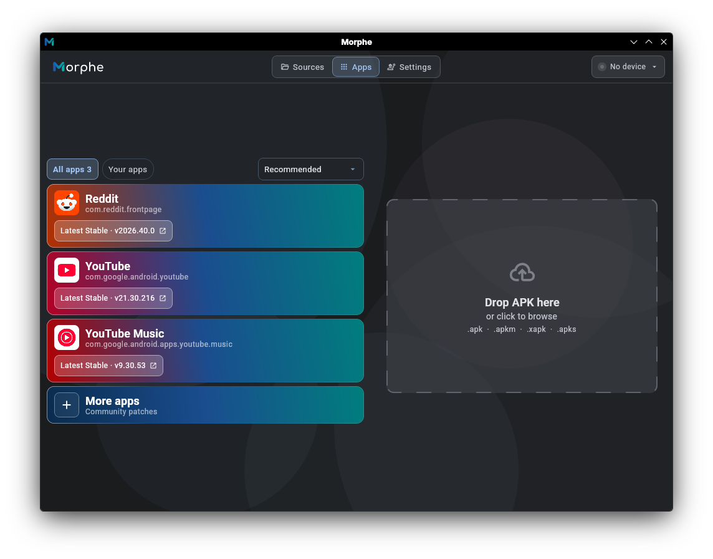
  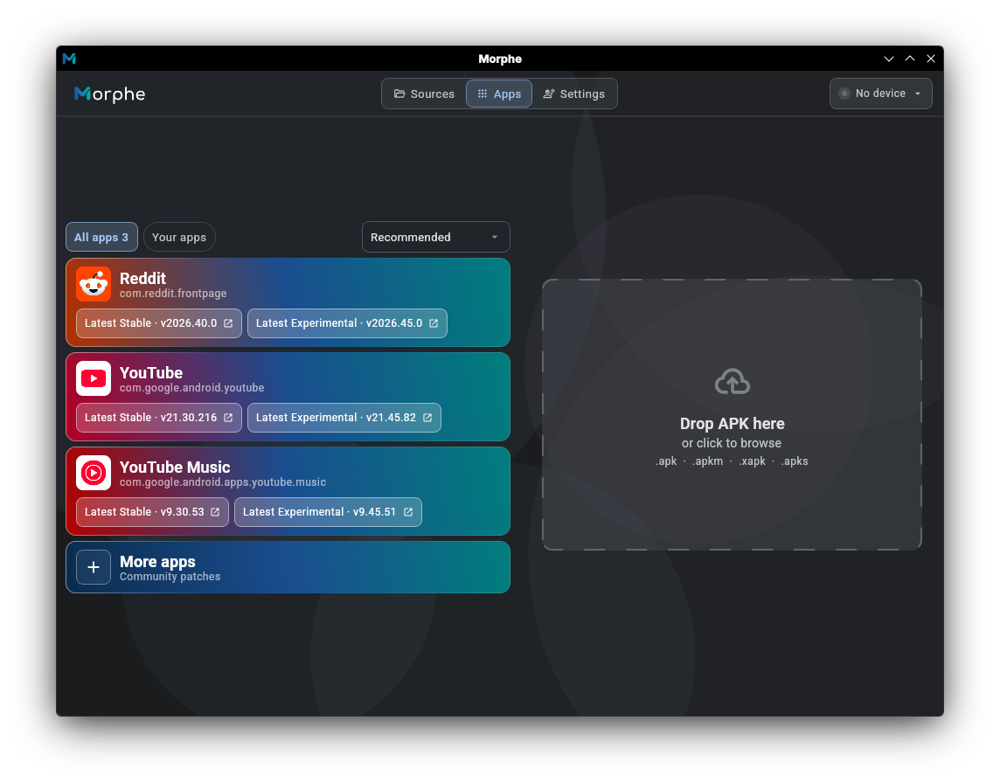
</p>

On first launch you're in **Simple** mode. Switch anytime in **Settings → Advanced → Expert mode → Toggle ON**. *[Morphe will remember that.]*

<p align="center">
  
</p>

<h3 id="gui-simple">Simple mode</h3>

Simple mode is the beginner path, covered step-by-step in the [first-run guide](../README.md#first-run):
1. On the **Apps** page, drag and drop an APK (or select one from the **Supported apps** list).
2. Morphe analyzes the package and checks patch compatibility across your enabled sources.
3. If multiple patch sources support the app, an inline source picker on the APK card lets you choose your preferred source (Morphe remembers your choice per app).
4. Click **Patch** to immediately begin patching using tested default patches.
5. The patching screen streams progress in a clean circular indicator, and on completion brings you straight to the result screen with an option to install via ADB or open the output folder. If a patch run fails, an in-depth failure screen appears with detailed error logs.

<h3 id="gui-expert">Expert mode</h3>

Expert mode is a five-screen pipeline giving you complete control over every step: **Apps (Home) → Patch source & version → Patch selection → Patching → Result**. Each screen below lists its controls (and the CLI flag it maps to, where there is one), then explains the details.

<h4 id="gui-window">The TopBar & Navigation Pill</h4>

The top bar sits at the top of the window and provides persistent navigation:

<p align="center">
  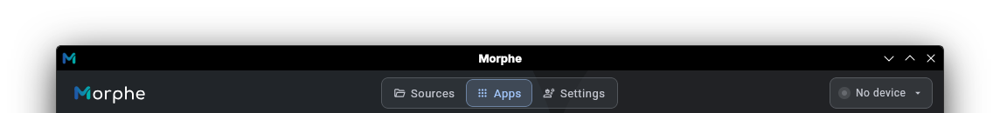
</p>

The **Navigation Pill** sits in the center of the bar with an animated sliding indicator between the two primary pages:

| Control                   | What it does                                                                                                                                                                                                                                                           |
|---------------------------|------------------------------------------------------------------------------------------------------------------------------------------------------------------------------------------------------------------------------------------------------------------------|
| **Sources** tab           | Opens the **Sources page** to add, edit, reorder, refresh, or remove patch sources and review signing keys – see [Managing patch sources](#gui-expert-sources).                                                                                                        |
| **Apps** tab              | Opens the **Apps page** with the APK staging area, Supported apps catalog, and Your apps patching history.                                                                                                                                                             |
| **Loading indicator**     | Displays an animated loading pill while patch manifests and releases are being fetched.                                                                                                                                                                               |
| **Offline badge**         | Appears when internet connectivity is unavailable; click to retry loading remote sources.                                                                                                                                                                              |
| **Device indicator**      | Shows the connected ADB device (or "No devices connected"). Click to choose the target device for installs.                                                                                                                                                            |
| **Tools** (wrench)        | One-off actions + reference info – see [Tools](#gui-tools).                                                                                                                                                                                                            |
| **Settings** (gear)       | Persistent preferences including themes, modes, signing, and native lib stripping – see [Settings](#gui-settings).                                                                                                                                                    |

<h4 id="gui-expert-home">1. Pick your APK</h4>


| Control                                          | What it does                                                                           | CLI equivalent                                                             |
|--------------------------------------------------|----------------------------------------------------------------------------------------|----------------------------------------------------------------------------|
| Drag & drop / **Browse files**                   | Choose the APK to patch (`.apk`, `.apkm`, `.xapk`, `.apks`)                            | positional `<apk>` argument                                                |
| **Supported apps** list                          | The apps your patches target, each tagged with compatibility status                    | informational – compare with [`list-versions`](#subcommand-3-list-versions) |
| **Patch source selector**                        | Choose which enabled source to patch with (in Simple mode when multiple sources exist) | `-p <source>`                                                              |
| **Change APK**                                   | Swap the selected file                                                                 | –                                                                          |
| **Patch** (Simple mode)                          | Immediately patch using default patches and selected source                            | runs the `patch` command with defaults                                     |
| **Continue** / **Continue anyway** (Expert mode) | Proceed to patch source & patch selection                                              | `--force` (when it reads *Continue anyway*)                                |

Drop an APK anywhere on the window (the zone reads **Drop APK here** → **Release to drop**) or use **Browse files**. Split-APK bundles (`.apkm` / `.xapk` / `.apks`) are merged into a single APK automatically.

The **Supported apps** list shows what your enabled patch sources can target, each tagged with its compatibility status:
- **Recommended** (primary color): The exact version tested and targeted by the patch bundle.
- **Supported** (primary color): Older supported app versions known to work.
- **Experimental** (warning color): Beta or experimental app releases supported by experimental patches.
- **Build unsupported** (error color): The app version is known, but the specific build code is not supported (the details show required build codes).
- **Unsupported** (error color): Untested or incompatible version outside known patch targets.

<p align="center">
  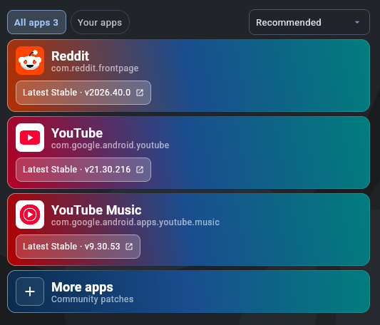
</p>

Once an APK is dropped, Morphe reads its metadata (**Analyzing** / "Reading app metadata…") and shows the APK card with the app name, package, version, and architecture info:
- In **Simple mode**: The card displays the default patch count and an inline patch source dropdown if multiple sources support the app. Click **Patch** to immediately begin patching.
- In **Expert mode**: The card displays native architecture details and a **Continue** (or **Continue anyway**) button to enter the patch selection pipeline.

<p align="center">
  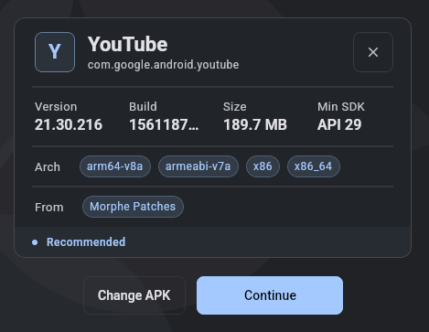
</p>

> [!TIP]
> Each version tag in the Supported apps list is a clickable shortcut. Click one to open that app's download page on [APKMirror](https://www.apkmirror.com/) or other related sites. Grab the **Recommended** version: matching versions ensures all default patches apply cleanly.

> [!NOTE]
> If your APK's version doesn't match what the patches expect, the button changes to **Continue anyway** (in Expert mode). Proceeding is the GUI's equivalent of the CLI's `--force`. Incompatible patches are skipped, and the ones that do apply may or may not work.

<p align="center">
  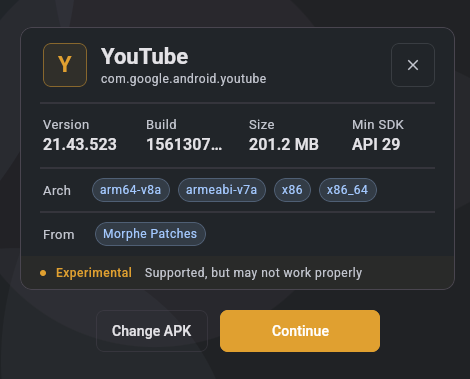
</p>

<h4 id="gui-expert-source">2. Choose a patch source & version</h4>


| Control                                                                                              | What it does                          | CLI equivalent                                                      |
|------------------------------------------------------------------------------------------------------|---------------------------------------|---------------------------------------------------------------------|
| Release list (**Latest** / **Stable** / **Prerelease** / **Cached**) + **Download** / **Select**     | Pick and fetch a patch release        | `-p <repo-url>` (+ `--prerelease` for **Prerelease**)                |
| **Patch notes**                                                                                      | Read a release's changelog            | -                                                                   |
| **Local patch file → Browse**                                                                        | Use a `.mpp` already on disk          | `-p <file.mpp>`                                                     |
| **Export JSON**                                                                                      | Save an `options.json` for this bundle | [`options-create`](#subcommand-4-options-create) / `--options-file` |

Morphe fetches the available releases from your configured source and tags them: **Latest**, **Stable**, **Prerelease** (experimental), and **Cached** (already downloaded). Pick one and **Download** / **Select** it. Expand **Patch notes** to read the changelog first. Already have a `.mpp`? **Local patch file → Browse** points straight at it. In Expert mode, you can also jump directly into a source's patches from the [Sources page](#gui-expert-sources).

<p align="center">
  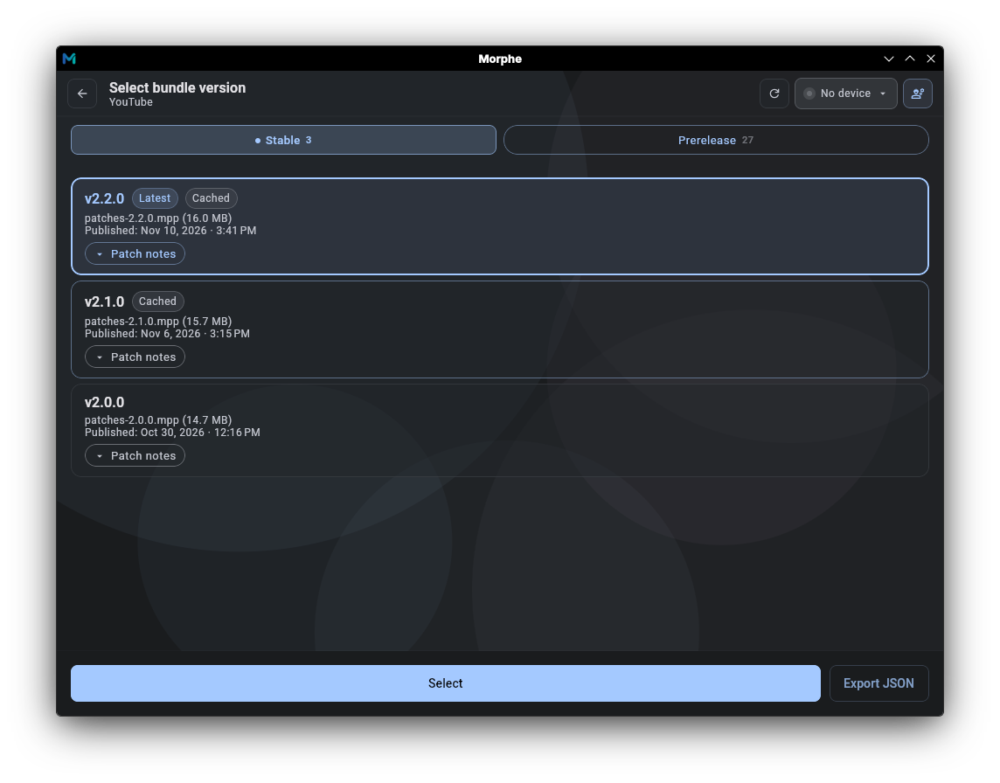
</p>

> [!NOTE]
> **Export JSON** writes an options file describing every patch and its settings – the same artifact the CLI's [`options-create`](#subcommand-4-options-create) produces. Edit it and feed it back via `--options-file` for repeatable, scriptable runs.

<h4 id="gui-expert-sources">Managing patch sources</h4>

The **Sources page** (accessed via the **Sources** tab in the top navigation pill) lets you manage the patch sources Morphe fetches from: add community sources (GitHub / GitLab repos, or `morphe.software/add-source` links), remove them, or refresh them on demand. Adding more than one source is the GUI counterpart to passing several `-p` URLs on the CLI: their patches show up together, grouped by bundle, on the patch selection screen.

Each source row displays its current version, release channel badge, and signing key fingerprint:

| Channel badge     | Meaning                                  |
|-------------------|------------------------------------------|
| 🟢 **Latest Stable** | Newest stable release – recommended      |
| 🟡 **Older Stable**  | A stable release, but a newer one exists |
| 🟣 **Prerelease**    | Newest pre-release (experimental)        |
| 🩵 **Local**         | A local `.mpp` file or folder source     |
| 🔴 **Error / Incompatible** | Source failed to fetch, or requires a different Patcher engine version |

**Reordering.** Drag a source by its handle to change its position in the list. Order represents **load priority** – sources higher in the list are loaded first. If two sources ship a patch or class with identical names, the one higher in priority wins.

**Local sources & Folder watching.** A local source can point at a `.mpp` file on disk. When [Developer options](#gui-settings-developer) is enabled, local sources can also point at a build **folder**. Morphe then automatically loads the newest `.mpp` built into that directory, and clicking **Refresh** re-scans the directory without restarting the app.

<p align="center">
  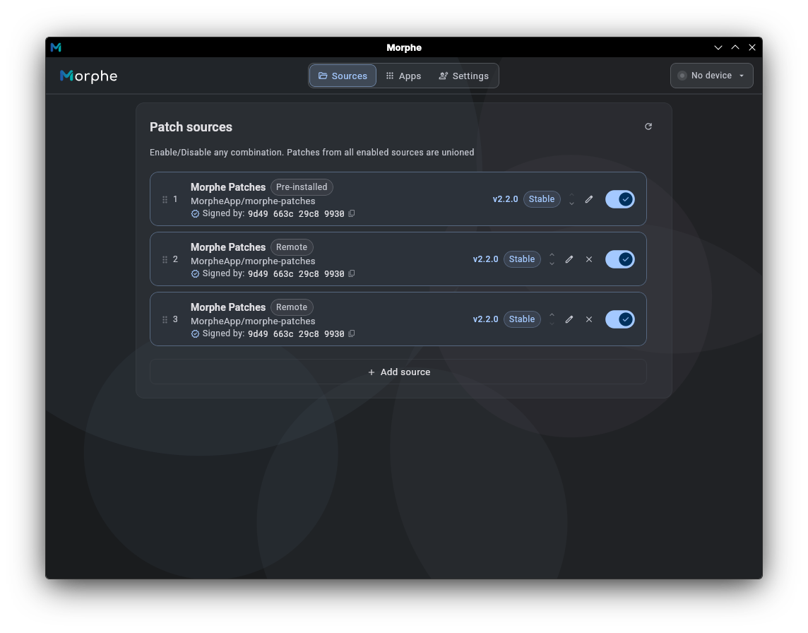
</p>

<h5 id="gui-signing-trust">Signing key verification & trust</h5>

To protect against tampered releases and compromised third-party repositories, Morphe cryptographically verifies every patch bundle before loading it:

- **Official Morphe Patches**: Automatically verified against Morphe's pinned official signing key.
- **Community Sources**: Uses a Trust-On-First-Use (TOFU) model. When a signed bundle is first loaded from a source, its public key fingerprint is pinned and displayed on the source row (`Signed by <fingerprint>`).
- **Key Changes**: If a source's signing key changes, or if a release is unexpectedly unsigned or signed by an unknown key, Morphe refuses the unverified bundle, flags the source with a **Key changed** badge, and displays a warning banner.
- **Reviewing & Trusting**: Clicking the badge opens the **Signing Key Trust Dialog** (`SigningKeyTrustDialog`), showing the previously trusted fingerprint alongside the new key's fingerprint. Only click **Trust** if the developer has officially announced a key rotation.

<h4 id="gui-expert-selection">3. Select patches</h4>

The full patch list from your selected bundle(s), with a running **"N of M selected"** count.

| Control                                                   | What it does                                                     | CLI equivalent                                   |
|-----------------------------------------------------------|------------------------------------------------------------------|--------------------------------------------------|
| Patch toggle                                              | Enable / disable a patch                                         | `-e` / `-d` (or `--ei` / `--di`)                 |
| Search                                                    | Filter the list                                                  | –                                                |
| **Patch Bundle Pills**                                    | Switch between patch bundles with live selection counts          | –                                                |
| Options editor                                            | Edit a patch's option values                                     | `-O key=value`                                   |
| **Patch defaults** / **Your defaults**                    | Whether you've changed a patch's options                         | –                                                |
| Strip-libs summary                                        | Which native-lib architectures will be kept                      | `--striplibs` (set in [Settings](#gui-settings)) |
| **Continue patching even if a patch fails**               | Keep going when a patch errors instead of aborting the whole run | `--continue-on-error`                            |
| **Command preview** (**Copy** / **Expand** / **Compact**) | The exact CLI command for your selections                        | – (it *is* the CLI command)                      |
| **Patch (N)**                                             | Start patching the N selected patches                            | runs the `patch` command                         |

- **Patch Bundle Pills & Grouping**: When multiple patch sources are loaded, Morphe presents each bundle in a pill capsule (`PatchBundlePill`) showing the bundle name, enabled patch count (`N / M`), and whether any patches match your search query. Within each bundle, patches are automatically organized into structured, collapsible categories (Universal, Ungrouped, and functional categories) by default.

<p align="center">
  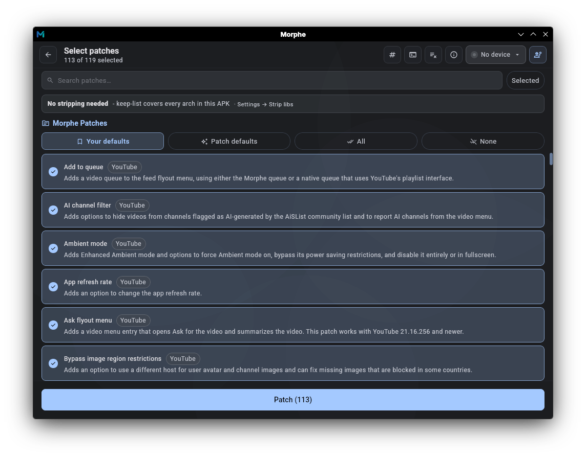
</p>

- **Options**: Patches with configurable options show an options count. Click on this to expand and edit. Values are typed, see the [Value Types Reference](#value-types-reference) for how strings / booleans / lists are formatted. **Patch defaults** means untouched. **Your defaults** means you've customized it. Rich option controls include color/hex pickers and the **custom icon** option, which opens the [Icon Studio](#gui-icon-studio).

<p align="center">
  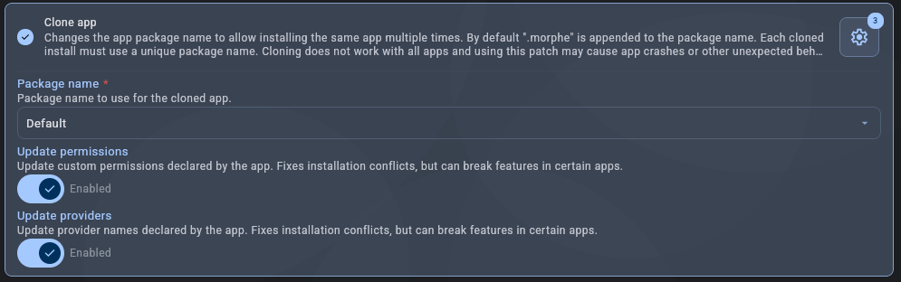
</p>

- **Strip libs**: A summary chip shows whether native libs will be stripped (**Stripping native libs** / **No stripping needed** / **No native libs**). Change the kept architectures under Settings → Strip Libs.
- **Continue patching even if a patch fails**: By default a failed patch aborts the whole run. Enable this to skip the failure and apply the rest. The GUI's equivalent of the CLI's `--continue-on-error`.
- **Command preview**: The exact CLI invocation your choices produce. **Copy** it to reproduce this run in a terminal or drop it into a script. **Expand** / **Compact** toggles full vs condensed.

<p align="center">
  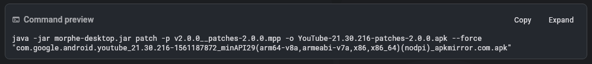
</p>

> [!TIP]
> The Command Preview is the best way to *learn* the CLI: configure a patch visually, copy the command, and you've got a reproducible one-liner. Handy for scripting or sharing exactly what you ran.

<h4 id="gui-icon-studio">Custom app icons (Icon Studio)</h4>

Some patches can replace the app's launcher icon. When a patch exposes a **custom icon** option (for example the **Custom branding** patch on the official Morphe patches), its row in the options editor shows action buttons instead of a plain text field:

| Control                         | What it does                                                                                   |
|---------------------------------|------------------------------------------------------------------------------------------------|
| **Design icon** / **Edit icon** | Open the **Icon Studio** to build a new icon (or re-open the one you saved)                    |
| **Select folder**               | Point the option at an already-prepared icon folder. E.g. one exported from the Morphe Manager |
| **Delete**                      | Clear the icon and delete its saved project + generated files                                  |

The patch expects a specific icon folder on disk, but you never have to build that by hand. The Icon Studio generates it and sets the option to its path. The row reads **Custom icon ready** once set, **No custom icon set** otherwise.

<p align="center">
  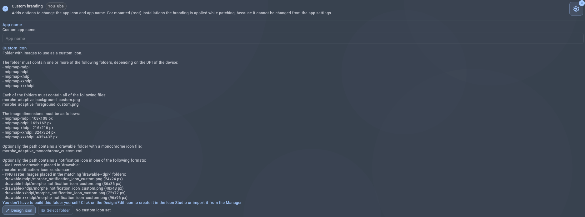
</p>

**Foreground vs. background.** Android adaptive icons are two layers: an **opaque background** and a **foreground** on top (the foreground may be transparent). The launcher masks the combined result into whatever shape the device uses. The Icon Studio mirrors this with two panels:

- **Foreground**: Your logo/mark, built from stacked **layers**. Each layer is an **Image**, **Text**, or a **Shape** (circle, square, rounded, triangle, and more). Per layer you get **Transform** (move / scale / rotate, with **Reset position**), color, and effects like **Shadow**, **Glow**, **Stroke**. Text layers add **Bold** / **Italic** / **Underline** / **Strike**; **Duplicate** copies a layer.
- **Background**: A **Solid** color, a **Gradient** (**Linear** / **Radial** / **Conic**), or an **Image**.

> [!IMPORTANT]
> **Transparency is the #1 reason a custom icon looks wrong**, and the two layers have opposite rules:
> - **The foreground should be transparent** around your mark. That cut-out is what makes the monochrome and notification icons read as a *shape*. A fully opaque foreground turns them into a solid block. If you import an opaque image the Studio **warns you** but won't auto-edit it (that could mangle a real icon). Fix it yourself with a transparent PNG, or use a **Text** / **Shape** layer instead.
> - **The background must be opaque**. Adaptive backgrounds can't be see-through. Here the Studio handles it *for* you. A transparent background image is **automatically flattened** onto a solid base, so backgrounds just work. (Although it is highly recommended to use a proper, fully opaque background.)

Colors come from a picker with saveable swatches, **TEMPLATES** give you starting points, and **UNDO** / **REDO** cover mistakes. Your work autosaves (the header shows **SAVED**), so **Edit icon** reopens exactly where you left off.

**Live previews.** The right side shows how the icon renders in three real contexts:

- **Adaptive** – the normal launcher icon (foreground over background).
- **Monochrome** – the themed/monochrome icon (Android 13+): a tinted silhouette of the *foreground*.
- **Notification / Status bar** – the small white silhouette used in the status bar and notifications, again derived from the foreground.

Because the monochrome and notification icons come from the foreground's shape and transparency, a background-only icon shows nothing in those two previews. That's expected, and the Studio points it out.

> [!NOTE]
> **Preview shapes** (circle, squircle, rounded, square) are only a *preview* of how different launchers might mask your icon. You don't pick the final shape. The device's launcher decides that, so your icon just needs to look right under any of them.

Hit **Save icon** to export the folder and wire it into the option (**Cancel** discards the current session), then patch as usual – the new icon is applied during patching.

<p align="center">
  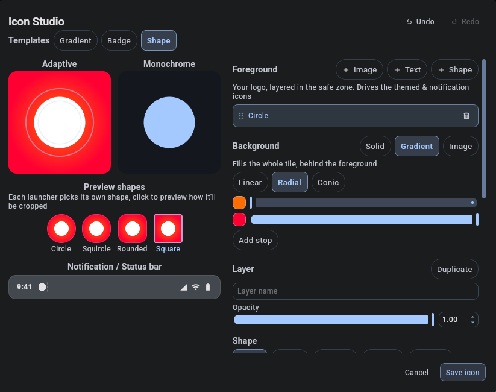
</p>

<h4 id="gui-expert-patching">4. Patching</h4>


| Control                        | What it does               | CLI equivalent               |
|--------------------------------|----------------------------|------------------------------|
| Live log + **N/total** counter | Streams progress           | (same output the CLI prints) |
| **Copy all**                   | Copy the full log          | –                            |
| **Log file → Reveal / View**   | Open the saved log on disk | –                            |
| **Cancel**                     | Stop the run               | –                            |

Morphe executes the patching pipeline and streams progress in real time:
- In **Simple mode**, patching runs inside a streamlined progress screen (`SimplePatchingContent`) featuring a progress indicator ring, the active step message, a completed patch count, and a **Cancel** button.
- In **Expert mode**, patching displays real-time **CPU and I/O usage monitoring graphs**, a live log stream with an **N/total** counter, and quick access to view or reveal saved log files (`morphe-data/logs/`, reachable via Tools → Open Logs).

On failure in either mode, Morphe presents an in-depth diagnosis screen (`ExpertFailureContent`) showing the error log and full stack trace. On success, the UI advances to the result screen.

<p align="center">
  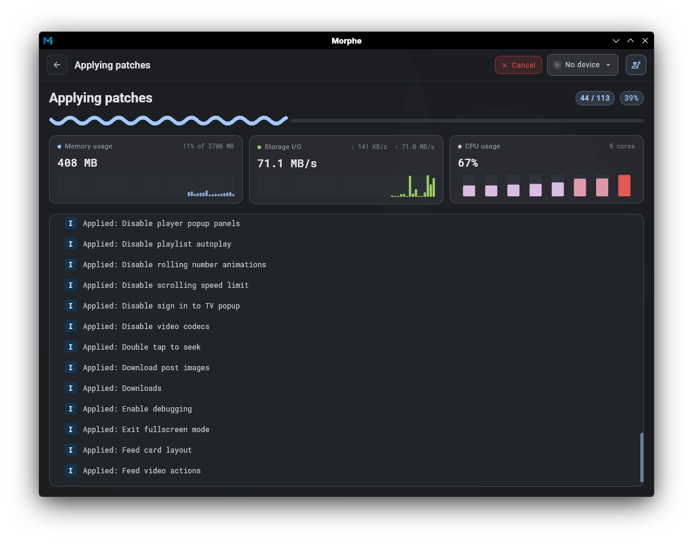
</p>

> [!TIP]
> If a patch fails, the saved log has the full stack trace: **View full logs**, or Tools → Open logs. It's exactly what to attach to a bug report.

<p align="center">
  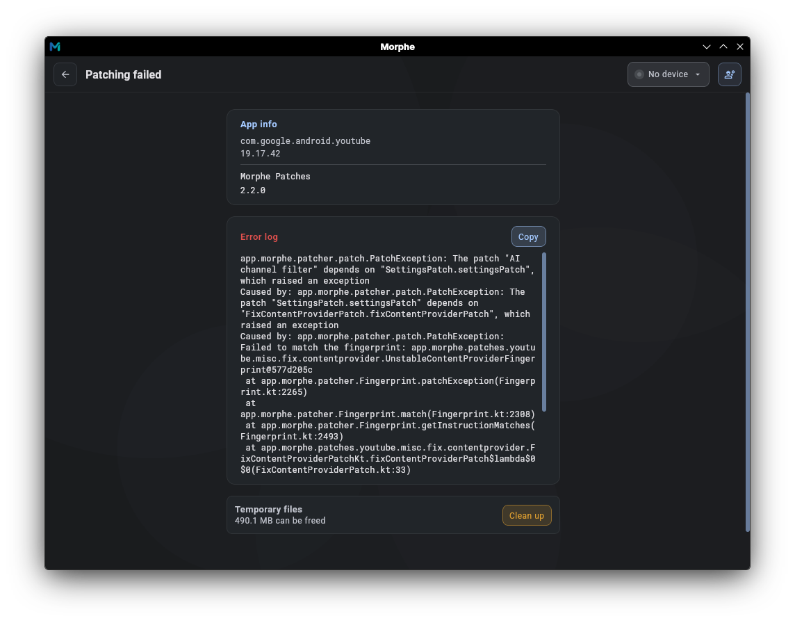
</p>

<h4 id="gui-expert-result">5. Result</h4>


| Control                             | What it does                  | CLI equivalent                                    |
|-------------------------------------|-------------------------------|---------------------------------------------------|
| **Output file** / **Open folder →** | Locate the patched APK        | output path is set by `-o` / `--out`              |
| **ADB install** (+ device picker)   | Install straight to a device  | `-i` / [`utility install`](#utility-install)      |
| **Patch another**                   | Start over with a new APK     | –                                                 |
| **Temporary files → Clean up**      | Free this run's scratch space | auto-purged by default; `--disable-purge` to keep |

- In **Simple mode**, the result screen (`SimpleResultContent`) presents a clean, focused view: output file location, an **Open folder** button, a one-click **ADB install** button (when ADB is enabled and a device is connected), and **Patch another** to return to the home screen.
- In **Expert mode**, the result screen also includes target device selection, temporary scratch file cleanup, and link handling configuration:
  - **Output file / Open folder →** – the finished APK and a button to reveal it in your file manager.
  - **ADB install** – with a device connected and ADB enabled, install directly. Pick a device (**Select a device**), wait for **Ready**, install; you'll see **INSTALLED ON &lt;device&gt;** on success or **RETRY** on failure. Device states include **Unauth** (accept the USB-debugging prompt on the phone) and **Unknown**. If ADB is off you'll see **Enable ADB** (turn on Auto-start ADB in Settings).
  - **Patch another** restarts the flow; **Temporary files → Clean up** frees this run's scratch space (it shows how much).

<p align="center">
  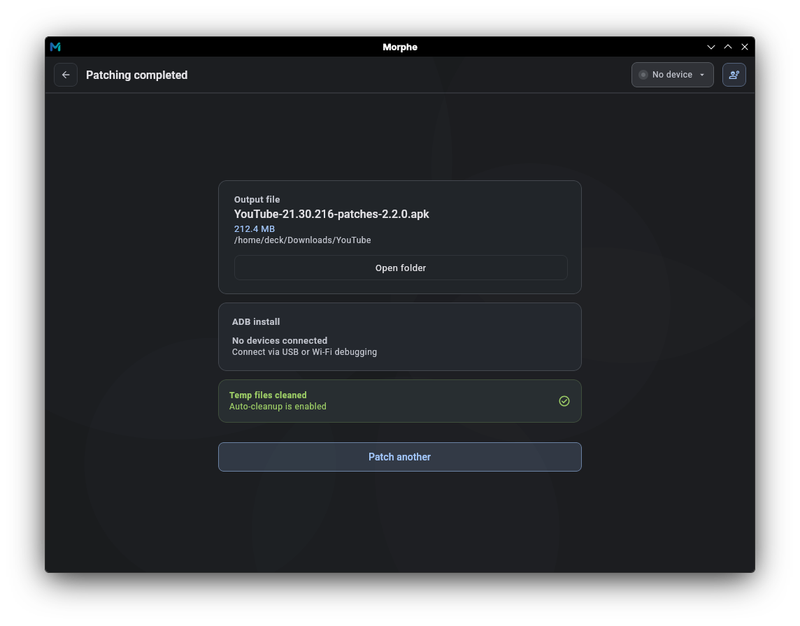
</p>

> [!NOTE]
> ADB is optional. Without it, just grab the APK from the output folder and install it however you like.

<h4 id="gui-expert-links">Link handling ("open with")</h4>

After installing to a device, Morphe can make the patched app handle its supported web links, so those links open in the patched app instead of your browser or the stock app. It's ADB-only and fully reversible.

| Control                                            | What it does                                                                                           | CLI equivalent                                      |
|----------------------------------------------------|--------------------------------------------------------------------------------------------------------|-----------------------------------------------------|
| **Open links with patched app**                    | Route the app's supported web links to it                                                              | [`utility install --route-links`](#utility-install) |
| **Also stop &lt;app&gt; from opening these links** | Hand the stock app's links over too – only when a rename patch was used and the stock app is installed | `--disable-stock <stockPackage>`                    |

The **Link handling** section appears on the Result screen once the patched app is installed and a device is connected. On success, you'll see *Links routed to patched app* (or *…, stock disabled*); the change is reversible, restoring default link handling. To run it automatically after every ADB install, turn on **Route links to patched app** in [Settings](#gui-settings).

<p align="center">
  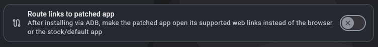
</p>

<h3 id="gui-your-apps">Your apps</h3>

The home screen has two tabs: **Supported apps** (what your patches can target) and **Your apps**, a history of everything you've patched with Morphe. The "Your apps" tab carries a count badge, and when newer patches are available a banner ("N patched apps have updates available") jumps you there.

<p align="center">
  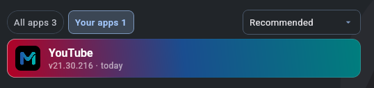
</p>

Each entry is a card showing the app, the patched version, and when you patched it. Tap one for the full breakdown and actions:


| Action        | What it does                                                                                      | CLI equivalent                            |
|---------------|---------------------------------------------------------------------------------------------------|-------------------------------------------|
| **Install**   | Install the patched APK to the connected device (shows **Install ready** when the build is ready) | [`utility install`](#utility-install)     |
| **Update**    | Re-resolve patches and re-patch when a newer patch (or app version) is available                  | re-run [`patch`](#subcommand-1-patch)      |
| **Re-patch**  | Patch the same app again with your saved settings                                                 | re-run [`patch`](#subcommand-1-patch)      |
| **Uninstall** | Remove the patched app from the connected device                                                  | [`utility uninstall`](#utility-uninstall) |
| **Forget**    | Remove the entry from Your apps (history only – doesn't touch the device)                         | –                                         |

The detail view provides a comprehensive breakdown of the patched app:
- **Collapsible patch and option sections**: Applied patches and custom option values are cleanly organized into disclosure sections with a built-in search filter.
- **Source re-selection & fallback**: If the patch source originally used to patch the app is currently disabled or has been removed, the dialog alerts you and provides an inline dropdown to select an alternative compatible source (or re-enable the original source).

**Uninstall vs. Forget.** *Uninstall* removes the app from your phone. Its dialog has an **"Also remove from Your apps"** checkbox to clear the history entry at the same time. *Forget* only drops the history entry and leaves the installed app untouched.

> [!NOTE]
> When Morphe installs over ADB it records a non-Play installer source, so the Play Store won't silently update (and overwrite) your patched app. This is automatic, there's no setting for it.

<p align="center">
  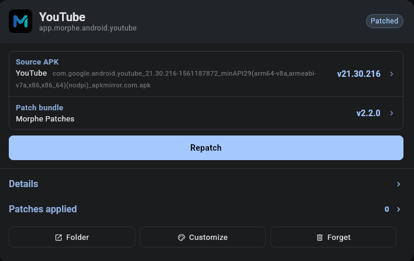
</p>

<h3 id="gui-settings">Settings</h3>

The gear icon opens Settings – Morphe's persistent preferences. Think of it as the GUI's equivalent of the CLI flag set: most settings map directly to a `patch` flag.


| Setting                        | What it does                                                                                              | Default                                                                              | CLI equivalent                                                                             |
|--------------------------------|-----------------------------------------------------------------------------------------------------------|--------------------------------------------------------------------------------------|--------------------------------------------------------------------------------------------|
| **Theme mode**                 | App color scheme: Light, Dark, Amoled (pure black), System                                                | System                                                                               | –                                                                                          |
| **Color style**                | Palette style: **Morphe** (dynamic colors and customized app cards) or **Monochrome** (pure monochrome)   | Morphe                                                                               | –                                                                                          |
| **Accent color**               | Dynamic custom accent color applied across the UI (available when Color style is Morphe)                  | Morphe Blue                                                                          | –                                                                                          |
| **Expert mode**                | Switch between Simple mode and Expert mode                                                                | Off (Simple mode)                                                                    | –                                                                                          |
| **Background animation**       | Choose an animated background style (e.g. Circles, Rings, Mesh, Space)                                    | Circles                                                                              | –                                                                                          |
| **Parallax effect**            | Smooth background shifting when moving the mouse                                                          | On                                                                                   | –                                                                                          |
| **Auto-cleanup temp files**    | Delete scratch files after patching                                                                       | On                                                                                   | On by default; `--disable-purge` to turn off                                               |
| **Auto-start ADB**             | Start the ADB daemon on launch so devices are monitored                                                   | Off                                                                                  | enables `-i` / install features                                                            |
| **Update channel**             | Stable or Prerelease app updates (dropdown menu)                                                          | Smart (Prerelease on dev builds, else Stable)                                        | `--prerelease` (loosely)                                                                   |
| **Output folder**              | Default location for patched APKs                                                                         | The input APK's folder                                                               | `-o` / `--out`                                                                             |
| **Signing**                    | Keystore + credentials used to sign                                                                       | Shared `morphe.keystore`, alias `Morphe`, key password `Morphe`, store password empty | `--keystore`, `--keystore-password`, `--keystore-entry-alias`, `--keystore-entry-password` |
| **Strip Libs**                 | Native-lib architectures to keep                                                                          | Keep all                                                                             | `--striplibs`                                                                              |
| **Patched app runtime logs**   | Capture logcat from a device after a patched app misbehaves                                               | –                                                                                    | –                                                                                          |
| **Route links to patched app** | After an ADB install, auto-route the app's web links to it (with an optional "disable stock app's links") | Off                                                                                  | [`utility install --route-links`](#utility-install)                                        |
| **Developer options**          | Unlock patch-developer workflows (point local source at a folder with auto-reloading newest .mpp)         | Off                                                                                  | –                                                                                          |

<p align="center">
  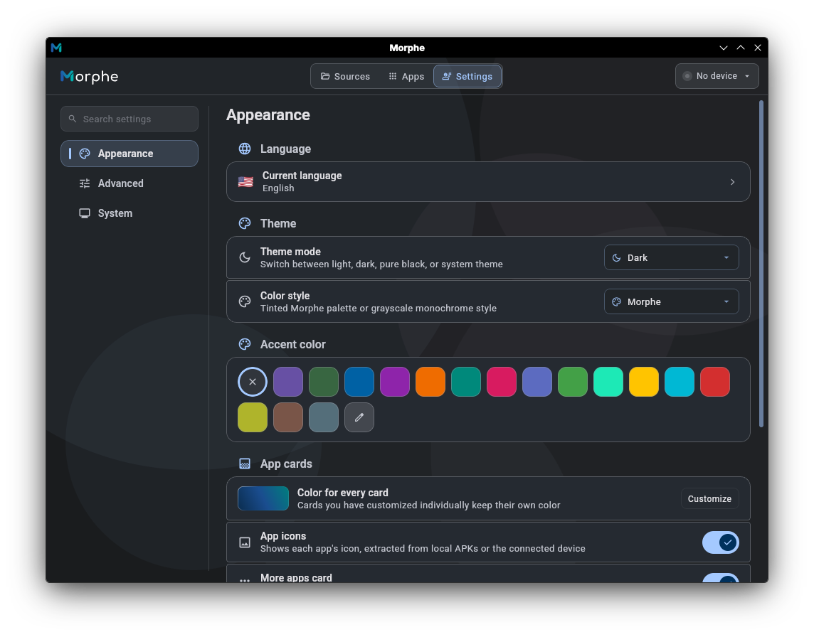
</p>

A couple of items worth expanding on:

- **About section & Changelogs** - The settings dialog includes an `About` tab that displays the application version, developer info, and a **View changelog** button. The Changelog dialog features structured release notes parsed into categorized sections (*App support*, *Fixes*, *Improvements*, *New*, *Performance*, *Changes*) with change counters, clickable links, inline code chips, and release status badges (*Installed*, *Latest*, *Pre-release*).
- **Auto-start ADB** - when off, Morphe never starts the ADB server and all install/push features are disabled. Turn it on to install patched APKs to your phone from Morphe.
- **Update channel** - *Prerelease* surfaces pre-releases; *Stable* only stable ones. If you've never chosen, Morphe defaults smartly (Prerelease when you're running a dev build).
- **Route links to patched app** - when on, every ADB install is followed by routing the app's supported web links to the patched app (the [Link handling](#gui-expert-links) step, run automatically). A nested **Disable stock app's links** option also stops the original app from opening those links – only relevant when a rename patch was used and the stock app is still installed. Both are reversible and need a connected device.

<h4 id="gui-settings-signing">Signing</h4>

This is the GUI face of the `--keystore*` flags. Morphe signs every patched APK so it's installable; by default it uses a single shared keystore in its data folder (see [Where Morphe stores its files](#where-files-stored)) and reuses it across runs – Android only lets you update an installed app with an APK signed by the **same** key, so a stable keystore keeps re-patches installable over old builds.


| Control                   | What it does                                              |
|---------------------------|-----------------------------------------------------------|
| Keystore path +**Browse** | Point at your own keystore file                           |
| **Reset**                 | Revert to Morphe's auto-generated default keystore        |
| **Keystore password**     | Password for the keystore file (default: the key password) |
| **Key alias**             | The key entry's alias (default:`Morphe`)                  |
| **Key password**          | The key entry's password (default:`Morphe`)               |
| **Verify credentials**    | Check the keystore opens with the entered alias/passwords |
| **Generate keystore**     | Create a fresh keystore                                   |
| **Export**                | Save the key as a `.p12` keystore that opens with the key password |

<p align="center">
  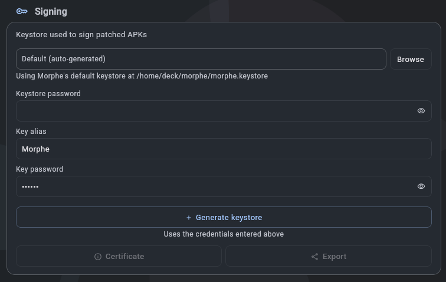
</p>

> [!WARNING]
> If Morphe can't find the configured keystore it warns *"Keystore not found – patching will fail until you restore it, pick another, or reset."* Use **Reset** to fall back to the default, or **Browse** to a valid one.

> [!NOTE]
> Morphe signs with **PKCS12** (`.p12` / `.pfx`), **BKS** and **JKS** (`.jks`) keystores as they are, telling them apart by their contents rather than their extension. Keystores it generates or exports are PKCS12, which other signing tools open too. (Same note as the CLI [`--keystore`](#subcommand-1-patch) flag.)

<h4 id="gui-settings-striplibs">Strip Libs</h4>

Choose which native-library architectures to keep in the patched APK; everything else is stripped, shrinking the file. This sets the default the Patch selection screen reports, and maps to the CLI's `--striplibs`.


| Architecture  | Use it for                             |
|---------------|----------------------------------------|
| `arm64-v8a`   | ARM 64-bit – most modern phones        |
| `armeabi-v7a` | ARM 32-bit – older phones              |
| `x86_64`      | Intel 64-bit – emulators / Chromebooks |
| `x86`         | Intel 32-bit – legacy emulators        |

<p align="center">
  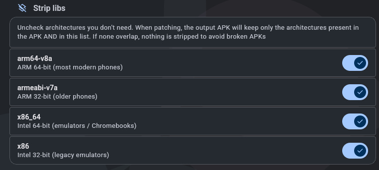
</p>

> [!WARNING]
> Only strip architectures your device doesn't use. If you keep just `arm64-v8a` and install on a 32-bit device (or the wrong emulator), the app won't run. When unsure, keep your phone's architecture (almost always `arm64-v8a`).

<h4 id="gui-settings-runtimelogs">Patched app runtime logs</h4>

A debugging aid: capture logcat from a connected device after a patched app crashes or misbehaves, to attach to a bug report. **Clear device logs** wipes logcat before you reproduce the issue; **Save device logs** then pulls the filtered output to a file. Both require a connected, ADB-authorized device.

<p align="center">
  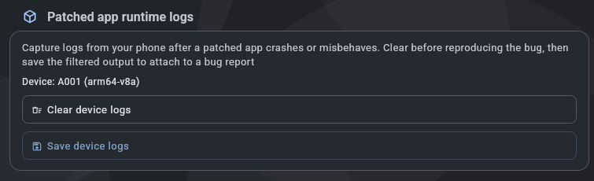
</p>

<h4 id="gui-settings-developer">Developer options</h4>

This section is for people **building** patches and other developers. Off by default. Toggling it on unlocks a suite of workflow options to better assist you in your development. Please feel free to make a request in the issues tab if you feel a feature could be added here.

**Folder sources.** Normally a local source points at a single `.mpp` file. With Developer options on, the add/edit source dialog gains a **Folder** button next to **File**. Pick a folder and Morphe always loads the **newest `.mpp`** inside it. Point it at your patch build-output directory once and you never re-pick the file: each rebuild is used on the next load. The [source sheet](#gui-expert-sources) also gains a **refresh** button (top-right) that re-scans on demand, so a patch you just built shows up without leaving the screen. Build outputs like `*-sources.mpp` and `*-javadoc.mpp` are always ignored, and you can set your own exclude patterns for a folder source from the source manager.

> [!NOTE]
> Existing folder sources keep working even if you later turn Developer options back off. The toggle only gates *creating* them.

<h3 id="gui-tools">Tools</h3>

The wrench icon opens Tools – one-off actions and reference info, kept out of Settings so a destructive action doesn't sit next to your preferences.


| Action            | What it does                                                                                                       |
|-------------------|--------------------------------------------------------------------------------------------------------------------|
| **Open logs**     | Open the logs folder (`morphe-data/logs/`)                                                                         |
| **Open app data** | Open Morphe's data folder – the`morphe-data/` directory (see [Where Morphe stores its files](#where-files-stored)) |
| **Clear cache**   | Delete downloaded patches and logs (they re-download as needed)                                                    |
| **View licenses** | Browse the open-source licenses of Morphe's dependencies                                                           |

<p align="center">
  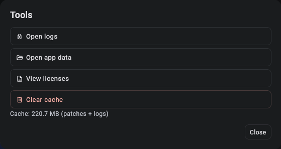
</p>

> [!NOTE]
> **Clear cache** asks for confirmation, then removes downloaded `.mpp` files and logs from `morphe-data/`. Nothing irreversible, patches re-download on the next run.

**View licenses** opens a searchable browser of the open-source licenses for every third-party library Morphe bundles. Use the search box to filter by name – handy for license compliance, or just to see what's under the hood.

<p align="center">
  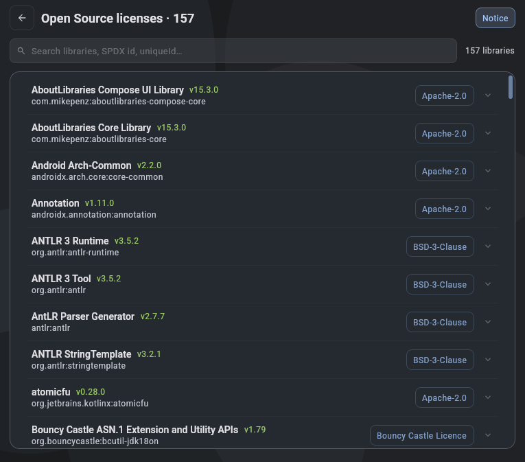
</p>

<h3 id="gui-adb">Installing to a device (ADB)</h3>

Morphe can push patched APKs straight to your phone over ADB:

1. Enable **Auto-start ADB** in Settings (off by default).
2. Connect your phone via USB with **USB debugging** enabled, and accept the authorization prompt on the device.
3. The **device indicator** in the top bar shows it; click to pick a device if several are connected.
4. After patching, use **ADB install** on the Result screen.

<p align="center">
  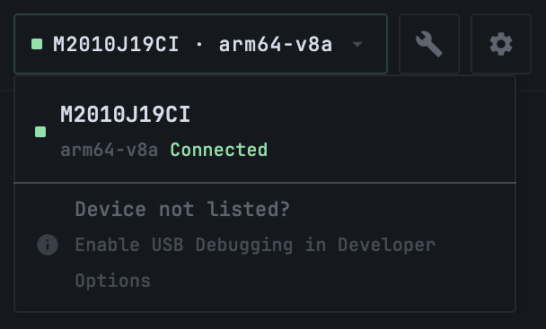
</p>

Device states you may see: **Ready** (good to go), **Unauth** (accept the USB-debugging prompt on the phone), **Unknown** (reconnect / check the cable), and **No devices connected**.

> [!NOTE]
> ADB is entirely optional: it only powers install-to-device. You can always patch without it and install the output APK manually.

<h2 id="cli">CLI</h2>

Prefer the terminal, or automating Morphe in a script or CI? The CLI exposes everything the [GUI](#gui) does – if you just want to patch an app, the GUI above is the easier path.

The CLI suite is an extremely powerful tool.
It has some general flags but is mainly divided into 5 main sub-commands (and they all lived in harmony, until the fire nation attacked. Caught that reference?):

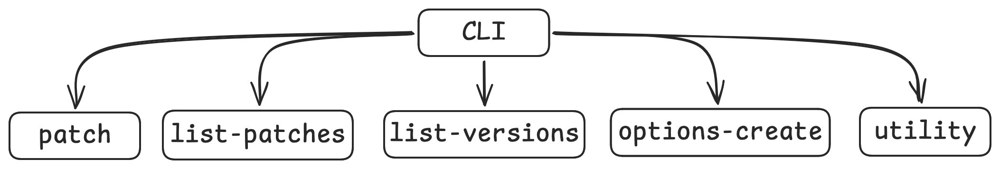

<h3 id="general-flags">General flags</h3>

#### `-h`, `--help`:

Shows all the general flags and sub commands available.

```
# Downloaded JAR:
java -jar morphe-desktop-*-all.jar --help

# Homebrew:
morphe --help
```

#### `-V`, `--version`:

Shows the current version of the morphe-desktop.jar

```
java -jar morphe-desktop-*-all.jar --version
```

<h3 id="subcommand-1-patch">Subcommand 1: <code>patch</code></h3>

This is the most fundamental sub-command. Add the `patch` keyword to run this sub-command.

```
# Downloaded JAR:
java -jar morphe-desktop-*-all.jar patch [flag/s]

# Homebrew:
morphe patch [flag/s]
```

Here is a quick lookup for all the flags under this subcommand:


| Flag                           | Description                                                                        |
|--------------------------------|------------------------------------------------------------------------------------|
| `-p`, `--patches`              | Paths to .mpp files, directories, or remote repos/PRs (repeatable, one per bundle) |
| `--prerelease`                 | Fetch latest dev pre-release instead of stable release                             |
| *(positional arg)*             | APK file to patch                                                                  |
| `-o`, `--out`                  | Path to save the patched APK to                                                    |
| `-e`, `--enable`               | Enable a patch by name                                                             |
| `--ei`                         | Enable a patch by index                                                            |
| `-d`, `--disable`              | Disable a patch by name                                                            |
| `--di`                         | Disable a patch by index                                                           |
| `-O`, `--options`              | Set patch option values (e.g.`-Okey=value`)                                        |
| `--exclusive`                  | Disable all patches except explicitly enabled ones                                 |
| `-f`, `--force`                | Skip APK version compatibility check                                               |
| `-i`, `--install`              | Install to ADB device (optional serial)                                            |
| `--mount`                      | Install by mounting over existing app (requires root)                              |
| `--keystore`                   | Path to keystore file for signing                                                  |
| `--keystore-password`          | Keystore password                                                                  |
| `--keystore-entry-alias`       | Alias of the key pair in the keystore                                              |
| `--keystore-entry-password`    | Password for the keystore entry                                                    |
| `--signer`                     | Signer name in the APK signature                                                   |
| `--unsigned`                   | Skip signing the final APK                                                         |
| `-t`, `--temporary-files-path` | Path to store temp files                                                           |
| `--disable-purge`              | Keep this run's scratch files (deleted after patching by default)                  |
| `--striplibs`                  | Architectures to keep, comma-separated (e.g.`arm64-v8a,x86`)                       |
| `--bytecode-mode`              | Bytecode mode:`FULL`, `STRIP_SAFE`, or `STRIP_FAST`                                |
| `--verify-with-sdk`            | Verify the patched DEX/APK using an Android SDK                                    |
| `--validate`                   | Verify each fingerprint `match()` matches only one method    |
| `--continue-on-error`          | Continue patching if a patch fails                                                 |
| `--options-file`               | Path to options JSON file                                                          |
| `--options-update`             | Auto-update options JSON file after patching                                       |
| `-r`, `--result-file`          | Path to save patching result JSON                                                  |

> [!NOTE]
> The examples used for each flag below only show the usage of that specific flag, but in practice, you'll almost always combine multiple flags together to customize your patching. Here's an example of a more complete command:
>
> ```
> java -jar morphe-desktop-*-all.jar patch -p patches.mpp -o your_app_patched.apk --striplibs arm64-v8a --force --continue-on-error -d "change package name" -d "spoof signature" "your_app.apk"
> ```

#### `-p`, `--patches`:

Required: Yes

Default: -

This flag specifies the patch file(s) to apply to your APK. You can pass local `.mpp` file paths, directories containing `.mpp` files, or remote repository URLs (GitHub/GitLab repos or GitHub pull requests), and you can repeat `-p` to combine several bundles in one run (see [Using multiple patch bundles](#using-multiple-bundles) below). When a directory is provided, Morphe automatically detects and resolves the newest `.mpp` bundle inside it. When a remote URL is provided, Morphe downloads the bundle and caches it on disk for future runs.

```
# Local file or directory:
java -jar morphe-desktop-*-all.jar patch --patches patches-*.mpp your_app.apk
java -jar morphe-desktop-*-all.jar patch --patches /path/to/patches/ your_app.apk
```

You can also pass a GitHub or GitLab repo URL:

```
java -jar morphe-desktop-*-all.jar patch --patches https://github.com/MorpheApp/morphe-patches your_app.apk
java -jar morphe-desktop-*-all.jar patch --patches https://gitlab.com/MorpheApp/morphe-patches your_app.apk
```

Or a specific release tag or Pull Request URL:

```
java -jar morphe-desktop-*-all.jar patch --patches https://github.com/MorpheApp/morphe-patches/releases/tag/v1.0.0 your_app.apk
java -jar morphe-desktop-*-all.jar patch --patches https://github.com/MorpheApp/morphe-patches/pull/123 your_app.apk
```

> [!NOTE]
> Downloading patch bundles from GitHub Pull Requests requires a GitHub Personal Access Token (PAT) with `public_repo` scope to access GitHub Actions artifacts.
>
> You can create a token at [github.com/settings/tokens](https://github.com/settings/tokens) (classic token with `public_repo` scope) and configure it via:
>
> - **Environment variable** (CLI): `export GITHUB_TOKEN="ghp_your_token"` (or `GH_TOKEN`)
> - **Settings UI / Config**: In the GUI under **Settings &rarr; GitHub Personal Access Token**

<h5 id="using-multiple-bundles">Using multiple patch bundles</h5>

`-p` can be repeated to combine several `.mpp` bundles in a single run:

```
java -jar morphe-desktop-*-all.jar patch -p patches-a.mpp -p patches-b.mpp your_app.apk
```

The **name-based** selection flags (`-e`, `-d`, `-O`) apply to the bundle they follow. Each `-p` starts a new bundle, and the selections after it belong to that bundle until the next `-p`:

```
java -jar morphe-desktop-*-all.jar patch -p patches-a.mpp -e "A patch from bundle A" -p patches-b.mpp -d "A patch from bundle B" your_app.apk
```

**Index-based** selections (`--ei`/`--di`) are the exception. Their numbers refer to the combined list across all supplied bundles, not a single one. Run `list-patches` with the same set of `--patches` files to see the combined numbering:

```
java -jar morphe-desktop-*-all.jar list-patches --patches patches-a.mpp --patches patches-b.mpp
```

Then enable/disable by those combined indices. The index points to a patch no matter which bundle it came from, so its position relative to each `-p` doesn't matter:

```
java -jar morphe-desktop-*-all.jar patch -p patches-a.mpp -p patches-b.mpp --ei 57 --di 12 your_app.apk
```

#### `--prerelease`:

Required: No

Default: `false`

When using a GitHub or GitLab repo URL with `--patches`, fetch the latest dev pre-release instead of the latest stable release. If no dev pre-release is found on the repository, Morphe falls back to the latest stable release automatically.

```
java -jar morphe-desktop-*-all.jar patch --patches https://github.com/MorpheApp/morphe-patches --prerelease your_app.apk
```

#### Positional argument (APK file):

Required: Yes

Default: -

The APK file you want to patch. This is passed directly without a flag name, at the end of the command.

```
java -jar morphe-desktop-*-all.jar patch -p patches.mpp your_app.apk
```

> [!NOTE]
> Morphe also supports `.apkm`, `.xapk`, and `.apks` files (split APK bundles). If you pass one of these, Morphe will automatically merge the splits into a single APK before patching.

#### `-o`, `--out`:

Required: No

Default: a subfolder named after the app, created next to the input APK – `<app>/<app>-<appVersion>-patches-<patchesVersion>.apk`

Specify a custom output path for the patched APK.

> [!NOTE]
> `<appVersion>` in the default name is read from the APK's manifest (`versionName`). Patching two different versions of the same app therefore produces two differently-named files instead of overwriting each other, even when the input files happen to share a name (for example both called `base.apk`).

```
java -jar morphe-desktop-*-all.jar patch -p patches.mpp -o /path/to/output.apk your_app.apk
```

#### `-e`, `--enable`:

Required: No

Default: -

Enable a specific patch by its exact name. Can be used multiple times to enable several patches.

```
java -jar morphe-desktop-*-all.jar patch -p patches.mpp -e "Patch name" -e "Another patch" your_app.apk
```

#### `--ei`:

Required: No

Default: -

Enable a specific patch by its index number. Can be used multiple times. Use `list-patches` to find the index of each patch.

```
java -jar morphe-desktop-*-all.jar patch -p patches.mpp --ei 1 --ei 5 your_app.apk
```

#### `-d`, `--disable`:

Required: No

Default: -

Disable a specific patch by its exact name. Can be used multiple times.

```
java -jar morphe-desktop-*-all.jar patch -p patches.mpp -d "Patch name" your_app.apk
```

#### `--di`:

Required: No

Default: -

Disable a specific patch by its index number. Can be used multiple times. Use `list-patches` to find the index of each patch.

```
java -jar morphe-desktop-*-all.jar patch -p patches.mpp --di 456 your_app.apk
```

> [!TIP]
> You can combine `-e`, `-d`, `--ei`, `--di` and `--exclusive` in the same command.
>
> ```
> java -jar morphe-desktop-*-all.jar patch -p patches.mpp --exclusive -e "Patch name" --ei 123 your_app.apk
> ```

#### `-O`, `--options`:

Required: No

Default: -

Set option values for patches. Options are key-value pairs passed alongside patch enable flags. To set a value to null, omit the value.

```
java -jar morphe-desktop-*-all.jar patch -p patches.mpp -e "Patch name" -Okey1=value1 -Okey2=value2 your_app.apk
```

To set an option to null:

```
java -jar morphe-desktop-*-all.jar patch -p patches.mpp -e "Patch name" -Okey1 your_app.apk
```

> [!WARNING]
> Option values are typed. Setting a value with the wrong type can cause the patch to fail. Use `list-patches --with-options` to inspect expected option types.
>
> Common types: `Boolean` (`true`/`false`), `String` (`"text"`), `Int` (`123`), `Long` (`123L`), `Float` (`1.0` / `1.0f`), `List` (`[item1,item2]`), and `File` (`/path/to/file`).

#### `--exclusive`:

Required: No

Default: `false`

Disable all patches except the ones you explicitly enable with `-e` or `--ei`. Useful when you only want a specific set of patches applied.

```
java -jar morphe-desktop-*-all.jar patch -p patches.mpp --exclusive -e "Patch name" your_app.apk
```

#### `-f`, `--force`:

Required: No

Default: `false`

Skip the APK version compatibility check. By default, Morphe will warn you and skip patches that aren't compatible with your APK's version. This flag forces all compatible patches to run regardless.

```
java -jar morphe-desktop-*-all.jar patch -p patches.mpp --force your_app.apk
```

> [!TIP]
> Patches are built for specific app versions.
> If you're using versions that are newer or older than the recommended ones, Morphe will skip all the incompatible patches (which is almost all of them since the version don't match) by default. **Use `--force` to apply them anyway** - they may still work fine, especially on recent versions.

#### `-i`, `--install`:

Required: No

Default: -

Automatically install the patched APK to a connected ADB device after patching.

If no serial is provided, Morphe installs to the first connected device. You can optionally specify a device serial.

```
# Install to default connected device:
java -jar morphe-desktop-*-all.jar patch -p patches.mpp your_app.apk -i
java -jar morphe-desktop-*-all.jar patch -p patches.mpp -i --mount your_app.apk

# Install to a specific device by serial:
java -jar morphe-desktop-*-all.jar patch -p patches.mpp -i SERIAL123 your_app.apk
```

> [!TIP]
> Make sure ADB is working before using this flag:
>
> ```
> adb shell exit
> ```

#### `--mount`:

Required: No

Default: `false`

Install the patched APK by mounting it on top of the original app. Requires root access and the original app to be installed on the device.

```
java -jar morphe-desktop-*-all.jar patch -p patches.mpp -i --mount your_app.apk
```

> [!NOTE]
> Make sure you have root permissions:
>
> ```
> adb shell su -c exit
> ```

#### `--keystore`:

Required: No

Default: the shared `morphe-data/morphe.keystore` (see [Where Morphe stores its files](#where-files-stored))

Path to a keystore file containing a private key and certificate pair to sign the patched APK with. If not specified, Morphe uses a single shared keystore in its data folder – auto-creating it on the first run and reusing it afterwards. Reusing one keystore is intentional: Android only lets you update an installed app with an APK signed by the **same** key, so a stable keystore means you can re-patch and reinstall over a previous build.

```
java -jar morphe-desktop-*-all.jar patch -p patches.mpp --keystore /path/to/keystore.p12 your_app.apk
```

> [!NOTE]
> The patcher signs with **PKCS12** (`.p12`/`.pfx`), **BKS** and **JKS** (`.jks`) keystores as they are, detecting the format from the file's contents (not its extension). The keystore it creates on the first run is PKCS12.

#### `--keystore-password`:

Required: No

Default: the key entry password (`--keystore-entry-password`), or none for a BKS keystore

Password to open the **keystore file** itself. A PKCS12 keystore conventionally shares the key *entry* password, which is how Morphe creates its default keystore, so you typically only need this flag when supplying your own keystore whose store password differs.

```
java -jar morphe-desktop-*-all.jar patch -p patches.mpp --keystore keystore.jks --keystore-password "mypassword" your_app.apk
```

> [!NOTE]
> The CLI and the Morphe Manager Android app share the same keystore defaults (alias `"Morphe"`, password `"Morphe"`), so a keystore generated by either tool works in the other without extra flags.

#### `--keystore-entry-alias`:

Required: No

Default: `"Morphe"`

The alias of the private key entry inside the keystore.

```
java -jar morphe-desktop-*-all.jar patch -p patches.mpp --keystore keystore.jks --keystore-entry-alias "my-alias" your_app.apk
```

#### `--keystore-entry-password`:

Required: No

Default: `"Morphe"`

Password for the specific keystore entry.

```
java -jar morphe-desktop-*-all.jar patch -p patches.mpp --keystore keystore.jks --keystore-entry-password "mypassword" your_app.apk
```

#### `--signer`:

Required: No

Default: `"Morphe"`

The name of the signer embedded in the APK signature.

```
java -jar morphe-desktop-*-all.jar patch -p patches.mpp --signer "My Signer" your_app.apk
```

#### `--unsigned`:

Required: No

Default: `false`

Skip signing the patched APK entirely. The output APK will not be signed and cannot be installed directly on a device without signing it separately.

```
java -jar morphe-desktop-*-all.jar patch -p patches.mpp --unsigned your_app.apk
```

#### `-t`, `--temporary-files-path`:

Required: No

Default: `morphe-data/tmp/` next to the JAR (falls back to `~/morphe/tmp/`)

Path to a directory where Morphe stores temporary files during patching.

```
java -jar morphe-desktop-*-all.jar patch -p patches.mpp -t /tmp/morphe-temp your_app.apk
```

#### `--disable-purge`:

Required: No

Default: `false`

By default, this run's scratch files are deleted once patching finishes. Pass this flag to keep them instead - useful for debugging a failed patch. Does not affect cached patches, other sessions, or config.

```
java -jar morphe-desktop-*-all.jar patch -p patches.mpp --disable-purge your_app.apk
```

#### `--striplibs`:

Required: No

Default: -

Comma-separated list of native library architectures to **keep**. All other architectures will be stripped from the APK, reducing file size.

```
java -jar morphe-desktop-*-all.jar patch -p patches.mpp --striplibs arm64-v8a,armeabi-v7a your_app.apk
```

#### `--bytecode-mode`:

Required: No

Default: `STRIP_FAST`

Controls how Morphe processes the APK's bytecode (DEX) during patching. Trade-off between speed, output size, and safety.


| Value        | Description                                                                                                                  |
|--------------|------------------------------------------------------------------------------------------------------------------------------|
| `FULL`       | Rebuilds and includes all bytecode. Largest output, slowest, safest - use if you hit runtime issues with the stripped modes. |
| `STRIP_SAFE` | Strips bytecode that is provably unused, while keeping anything reachable via reflection or dynamic loading.                 |
| `STRIP_FAST` | Default. Aggressively strips unused bytecode for the smallest, fastest build. May break apps that rely on reflection.        |

```
java -jar morphe-desktop-*-all.jar patch -p patches.mpp --bytecode-mode FULL your_app.apk
```

> [!TIP]
> If a patched app crashes at startup or has odd missing-class errors, switch to `STRIP_SAFE` or `FULL` and see if it fixes things.

> [!NOTE]
> On Windows, Morphe currently forces bytecode mode to `FULL` regardless of what you pass to this flag (workaround for a platform-specific issue). The flag still works as expected on macOS and Linux.

#### `--verify-with-sdk`:

Required: No

Default: - (verification is skipped)

Verify the patched DEX and APK files using a local Android SDK after patching. Helpful for catching corrupt output before installing on a device. Pass a path to your SDK install directory, or pass the flag without a path to let Morphe auto-discover one.

```
# Specify SDK path explicitly:
java -jar morphe-desktop-*-all.jar patch -p patches.mpp --verify-with-sdk /path/to/android-sdk your_app.apk

# Auto-discover SDK (place the flag after the APK or before another flag):
java -jar morphe-desktop-*-all.jar patch -p patches.mpp your_app.apk --verify-with-sdk
java -jar morphe-desktop-*-all.jar patch -p patches.mpp --verify-with-sdk --unsigned your_app.apk
```

> [!NOTE]
> When you pass `--verify-with-sdk` without a path, Morphe resolves the SDK in this order:
>
> 1. `$ANDROID_HOME`
> 2. `$ANDROID_SDK_ROOT`
> 3. OS-default install location:
>    - macOS: `~/Library/Android/sdk`
>    - Windows: `~/AppData/Local/Android/Sdk`
>    - Linux: `~/Android/Sdk`
>
> If none of those resolve to a real SDK, Morphe errors out with a hint to either set one of the env vars or supply a path explicitly.

#### `--validate`:

Required: No

Default: `false`

For patch developers. Forces every fingerprint `match()` to behave like `matchSingle()`, so patching fails if a fingerprint matches more than one method. This verifies a fingerprint cannot match a different method if a later version of the app changes the order of its classes or methods. Usage of `matchAll()` is unaffected. Patching is slower, because each fingerprint searches all classes.

```
java -jar morphe-desktop-*-all.jar patch -p patches.mpp --validate your_app.apk
```

#### `--continue-on-error`:

Required: No

Default: `false`

By default, patching stops on the first patch failure. This flag lets Morphe continue applying the remaining patches even if one fails.

```
java -jar morphe-desktop-*-all.jar patch -p patches.mpp --continue-on-error your_app.apk
```

#### `--options-file`:

Required: No

Default: -

Path to a JSON file that controls which patches are enabled/disabled and their option values. Generate one using the `options-create` subcommand.

```
java -jar morphe-desktop-*-all.jar patch -p patches.mpp --options-file options.json your_app.apk
```

> [!NOTE]
> If the file you specify doesn't exist yet, Morphe will automatically generate one with default values at that path and use it for the current patch. This means you can skip `options-create` entirely - just pass a path to a non-existent file and Morphe will create it for you.

> [!NOTE]
> Command-line flags (`-e`, `-d`, `--ei`, `--di`, `-O`) take precedence over the options and selections defined in `--options-file`.

> [!TIP]
> The options file is great for repeatable patching. Generate it once (either with `options-create` or by letting `--options-file` auto-generate it), tweak it, and reuse it every time you patch.

#### `--options-update`:

Required: No

Default: `false`

Automatically update the options JSON file after patching to reflect the current patches. Without this flag, the file is left unchanged. New patches get added, removed patches get cleaned up.

```
java -jar morphe-desktop-*-all.jar patch -p patches.mpp --options-file options.json --options-update your_app.apk
```

#### `-r`, `--result-file`:

Required: No

Default: -

Path to save a JSON file containing the patching result. The file records:

- the package name and version of the patched app
- whether patching succeeded overall
- the result of each patching step
- the list of applied patches
- the list of failed patches, with their error details

```
java -jar morphe-desktop-*-all.jar patch -p patches.mpp -r result.json your_app.apk
```

---

<h3 id="subcommand-2-list-patches">Subcommand 2: <code>list-patches</code></h3>

Lists all available patches from the supplied MPP files. Useful for finding patch names, indices, compatible packages, and options before patching.

```
java -jar morphe-desktop-*-all.jar list-patches --patches patches.mpp [flag/s]
```

Here is a quick lookup for all the flags under this subcommand:


| Flag                             | Description                                            |
|----------------------------------|--------------------------------------------------------|
| `--patches`                      | Paths to .mpp files, directories, or remote repos/PRs  |
| `--prerelease`                   | Fetch latest dev pre-release instead of stable release |
| `--out`                          | Write patch list to a file instead of stdout           |
| `-d`, `--with-descriptions`      | Show patch descriptions                                |
| `-p`, `--with-packages`          | Show compatible packages                               |
| `-v`, `--with-versions`          | Show compatible versions                               |
| `-o`, `--with-options`           | Show patch options                                     |
| `-u`, `--with-universal-patches` | Include patches compatible with any app                |
| `-i`, `--index`                  | Show patch index                                       |
| `-f`, `--filter-package-name`    | Filter patches by package name                         |
| `-x`, `--include-experimental`   | Include experimental app versions in the output        |

#### `--patches`:

Required: Yes

Default: -

One or more paths to `.mpp` patch files, directories containing `.mpp` files, or remote repository URLs (GitHub/GitLab repos or GitHub pull requests) to list patches from. When a directory is provided, Morphe automatically detects and resolves the newest `.mpp` bundle inside it. When a remote URL is provided, Morphe downloads the bundle and caches it on disk for future runs.

```
java -jar morphe-desktop-*-all.jar list-patches --patches patches.mpp
java -jar morphe-desktop-*-all.jar list-patches --patches /path/to/patches/
java -jar morphe-desktop-*-all.jar list-patches --patches https://github.com/MorpheApp/morphe-patches
```

#### `--prerelease`:

Required: No

Default: `false`

When using a GitHub or GitLab repo URL with `--patches`, fetch the latest dev pre-release instead of the latest stable release (automatically falling back to the other channel if the preferred channel is not available).

```
java -jar morphe-desktop-*-all.jar list-patches --patches https://github.com/MorpheApp/morphe-patches --prerelease
```

#### `--out`:

Required: No

Default: -

Write the patch list to a file instead of printing to stdout. Useful in environments where `>` redirection is not available.

```
java -jar morphe-desktop-*-all.jar list-patches --patches patches.mpp --out patches-list.txt
```

#### `-d`, `--with-descriptions`:

Required: No

Default: `true`

Show the description of each patch. Enabled by default - use `--with-descriptions=false` to hide them.

```
java -jar morphe-desktop-*-all.jar list-patches --patches patches.mpp --with-descriptions=false
```

#### `-p`, `--with-packages`:

Required: No

Default: `false`

Show the packages each patch is compatible with.

```
java -jar morphe-desktop-*-all.jar list-patches --patches patches.mpp --with-packages
```

#### `-v`, `--with-versions`:

Required: No

Default: `false`

Show the compatible app versions for each patch. Requires `--with-packages` to be useful.

```
java -jar morphe-desktop-*-all.jar list-patches --patches patches.mpp --with-packages --with-versions
```

#### `-o`, `--with-options`:

Required: No

Default: `false`

Show the configurable options for each patch, including their keys, types (`Boolean`, `String`, `Int`, `Long`, `Float`, `List`, `File`), default values, and possible values.

```
java -jar morphe-desktop-*-all.jar list-patches --patches patches.mpp --with-options
```

#### `-u`, `--with-universal-patches`:

Required: No

Default: `true`

Include patches that are compatible with any app (universal patches). Use `--with-universal-patches=false` to only show patches targeting specific packages.

```
java -jar morphe-desktop-*-all.jar list-patches --patches patches.mpp --with-universal-patches=false
```

#### `-i`, `--index`:

Required: No

Default: `true`

Show the index of each patch. The index can be used with `--ei` and `--di` in the `patch` subcommand.

```
java -jar morphe-desktop-*-all.jar list-patches --patches patches.mpp
```

#### `-f`, `--filter-package-name`:

Required: No

Default: -

Only show patches that are compatible with the specified package name.

```
java -jar morphe-desktop-*-all.jar list-patches --patches patches.mpp --filter-package-name com.google.android.youtube
```

#### `-x`, `--include-experimental`:

Required: No

Default: `false`

By default, only stable app versions are listed. Pass this flag to also include experimental versions.

```
java -jar morphe-desktop-*-all.jar list-patches --patches patches.mpp --include-experimental
```

---

<h3 id="subcommand-3-list-versions">Subcommand 3: <code>list-versions</code></h3>

Lists the most common compatible app versions for the patches in the supplied MPP files. Useful for knowing which APK version to download before patching.

```
java -jar morphe-desktop-*-all.jar list-versions --patches patches.mpp [flag/s]
```

Here is a quick lookup for all the flags under this subcommand:


| Flag                           | Description                                            |
|--------------------------------|--------------------------------------------------------|
| `--patches`                    | Paths to .mpp files, directories, or remote repos/PRs  |
| `--prerelease`                 | Fetch latest dev pre-release instead of stable release |
| `-f`, `--filter-package-names` | Filter by package names                                |
| `-u`, `--count-unused-patches` | Include unused patches in the version count            |
| `-x`, `--include-experimental` | Include experimental app versions in the output        |

#### `--patches`:

Required: Yes

Default: -

One or more paths to `.mpp` patch files, directories containing `.mpp` files, or remote repository URLs (GitHub/GitLab repos or GitHub pull requests). When a directory is provided, Morphe automatically detects and resolves the newest `.mpp` bundle inside it. When a URL is provided, Morphe downloads the bundle and caches it on disk for future runs.

```
java -jar morphe-desktop-*-all.jar list-versions --patches patches.mpp
java -jar morphe-desktop-*-all.jar list-versions --patches /path/to/patches/
java -jar morphe-desktop-*-all.jar list-versions --patches https://github.com/MorpheApp/morphe-patches
```

#### `--prerelease`:

Required: No

Default: `false`

When using a GitHub or GitLab repo URL with `--patches`, fetch the latest dev pre-release instead of the latest stable release (automatically falling back to the other channel if the preferred channel is not available).

```
java -jar morphe-desktop-*-all.jar list-versions --patches https://github.com/MorpheApp/morphe-patches --prerelease
```

#### `-f`, `--filter-package-names`:

Required: No

Default: -

Only show versions for the specified package names. Can be used to check versions for a specific app, or specified multiple times to filter for multiple apps.

```
java -jar morphe-desktop-*-all.jar list-versions --patches patches.mpp -f com.google.android.youtube
java -jar morphe-desktop-*-all.jar list-versions --patches patches.mpp -f com.google.android.youtube -f com.google.android.apps.youtube.music
```

#### `-u`, `--count-unused-patches`:

Required: No

Default: `false`

Include patches that are not enabled by default when calculating the most common compatible versions. By default, only patches that are enabled are counted.

```
java -jar morphe-desktop-*-all.jar list-versions --patches patches.mpp --count-unused-patches
```

#### `-x`, `--include-experimental`:

Required: No

Default: `false`

By default, only stable app versions are counted and shown. Pass this flag to also include experimental versions.

```
java -jar morphe-desktop-*-all.jar list-versions --patches patches.mpp --include-experimental
```

---

<h3 id="subcommand-4-options-create">Subcommand 4: <code>options-create</code></h3>

Creates or updates an options JSON file for controlling which patches are enabled/disabled and their option values. The generated file can be passed to the `patch` subcommand with `--options-file`.

```
java -jar morphe-desktop-*-all.jar options-create [flag/s]
```

Here is a quick lookup for all the flags under this subcommand:


| Flag                           | Description                                            |
|--------------------------------|--------------------------------------------------------|
| `--patches`                    | Paths to .mpp files, directories, or remote repos/PRs  |
| `--prerelease`                 | Fetch latest dev pre-release instead of stable release |
| `-o`, `--out`                  | Path to the output JSON file                           |
| `-f`, `--filter-package-name`  | Filter patches by package name                         |

#### `-p`, `--patches`:

Required: Yes

Default: -

One or more paths to `.mpp` patch files, directories containing `.mpp` files, or remote repository URLs (GitHub/GitLab repos or GitHub pull requests) to generate options from. When a directory is provided, Morphe automatically detects and resolves the newest `.mpp` bundle inside it. Multiple `-p` flags can be supplied to include options from multiple bundles in a single file. When a URL is provided, Morphe downloads the bundle and caches it on disk for future runs.

```
java -jar morphe-desktop-*-all.jar options-create -p patches.mpp -o options.json
java -jar morphe-desktop-*-all.jar options-create -p /path/to/patches/ -o options.json
java -jar morphe-desktop-*-all.jar options-create -p https://github.com/MorpheApp/morphe-patches -o options.json
```

#### `--prerelease`:

Required: No

Default: `false`

When using a GitHub or GitLab repo URL with `--patches`, fetch the latest dev pre-release instead of the latest stable release (automatically falling back to the other channel if the preferred channel is not available).

```
java -jar morphe-desktop-*-all.jar options-create -p https://github.com/MorpheApp/morphe-patches --prerelease -o options.json
```

#### `-o`, `--out`:

Required: Yes

Default: -

Path to the output JSON file. If the file already exists, Morphe merges the current patches into it - preserving your existing settings, adding new patches, and removing patches that no longer exist. If the existing file is corrupted or contains invalid JSON, Morphe warns and regenerates a fresh options file.

```
java -jar morphe-desktop-*-all.jar options-create -p patches.mpp -o options.json
```

> [!TIP]
> Run this command again after updating your .mpp file to keep your options file in sync. Existing settings are preserved.

#### `-f`, `--filter-package-name`:

Required: No

Default: -

Only include patches compatible with the specified package name in the generated options file.

```
java -jar morphe-desktop-*-all.jar options-create -p patches.mpp -o options.json -f com.google.android.youtube
```

#### Options JSON Workflow

The options JSON file lets you save your patch preferences and reuse them across multiple patching sessions. Here's the typical workflow:

**Step 1: Generate the options file**

Use `options-create` to generate a JSON file with all available patches and their default settings:

```
java -jar morphe-desktop-*-all.jar options-create -p patches.mpp -o options.json
```

**Step 2: Edit the file**

Open `options.json` in any text editor. You can enable/disable patches and set option values. The file contains a list of patch bundles, each with patch entries that look like:

```json
{
  "patchName": {
    "enabled": true,
    "options": {
      "optionKey": "optionValue"
    }
  }
}
```

Set `"enabled": false` to disable a patch, or change option values as needed.

**Step 3: Patch using the options file**

Pass your customized options file to the `patch` command:

```
java -jar morphe-desktop-*-all.jar patch -p patches.mpp --options-file options.json your_app.apk
```

**Step 4: Keep the file in sync (optional)**

When you update your .mpp file to a newer version, patches may be added or removed. You have two ways to sync:

- Re-run `options-create` - this merges new patches in while preserving your existing settings:

  ```
  java -jar morphe-desktop-*-all.jar options-create -p patches.mpp -o options.json
  ```
- Use `--options-update` during patching - this auto-updates the file after patching:

  ```
  java -jar morphe-desktop-*-all.jar patch -p patches.mpp --options-file options.json --options-update your_app.apk
  ```

> [!NOTE]
> CLI flags (`-e`, `-d`, `--ei`, `--di`, `-O`) always take precedence over the options file. If you enable a patch via CLI that the options file disables, the CLI wins. Morphe will log when this happens.

> [!TIP]
> You can also skip `options-create` entirely. If you pass `--options-file` with a path that doesn't exist yet, Morphe will auto-generate the file with defaults for you.

---

<h3 id="subcommand-5-utility">Subcommand 5: <code>utility</code></h3>

Parent command for utility operations. It allows for things like manually installing or uninstalling apps via ADB, clearing the cache directory, etc. Has three sub-subcommands: `install`, `uninstall`, and `clear-cache`.

<h4 id="utility-install"><code>utility install</code></h4>

Manually install an APK file to one or more ADB-connected devices.

```
java -jar morphe-desktop-*-all.jar utility install [flag/s] [device-serial...]
```


| Flag               | Description                                                               |
|--------------------|---------------------------------------------------------------------------|
| `-a`, `--apk`      | APK file to install                                                       |
| `-m`, `--mount`    | Mount over an existing app (requires package name and root)               |
| `--route-links`    | After installing, route the app's supported web links to it ("open with") |
| `--disable-stock`  | With`--route-links`: also stop the named stock package from handling them |
| *(positional arg)* | ADB device serial(s)                                                      |

##### `-a`, `--apk`:

Required: Yes

Default: -

Path to the APK file you want to install.

```
java -jar morphe-desktop-*-all.jar utility install -a patched_app.apk
```

##### `-m`, `--mount`:

Required: No

Default: -

Mount the APK on top of an existing app instead of a regular install. Pass the package name of the app to mount over. Requires root access.

```
java -jar morphe-desktop-*-all.jar utility install -a patched_app.apk -m com.google.android.youtube
```

##### `--route-links`:

Required: No

Default: -

After installing, route the app's supported web links to it ("open with"), so they open in the patched app instead of the browser or the stock app. The package name is read from the APK, so no value is needed.

```
java -jar morphe-desktop-*-all.jar utility install -a patched_app.apk --route-links
```

##### `--disable-stock`:

Required: No

Default: -

Use with `--route-links`. Also stops the named stock package from handling those links – needed when a rename patch was applied and the original app is still installed.

```
java -jar morphe-desktop-*-all.jar utility install -a patched_youtube.apk --route-links --disable-stock com.google.android.youtube
```

##### Positional argument (device serials):

Required: No

Default: First connected device

One or more ADB device serials to install to. If not provided, installs to the first connected device.

```
java -jar morphe-desktop-*-all.jar utility install -a patched_app.apk SERIAL1 SERIAL2
```

---

<h4 id="utility-uninstall"><code>utility uninstall</code></h4>

Manually uninstall a patched app from one or more ADB-connected devices.

```
java -jar morphe-desktop-*-all.jar utility uninstall [flag/s] [device-serial...]
```


| Flag                   | Description                          |
|------------------------|--------------------------------------|
| `-p`, `--package-name` | Package name of the app to uninstall |
| `-u`, `--unmount`      | Unmount instead of uninstall         |
| *(positional arg)*     | ADB device serial(s)                 |

##### `-p`, `--package-name`:

Required: Yes

Default: -

The package name of the app to uninstall.

```
java -jar morphe-desktop-*-all.jar utility uninstall -p com.google.android.youtube
```

##### `-u`, `--unmount`:

Required: No

Default: `false`

If the app was installed by mounting (using `--mount`), use this flag to unmount it instead of a regular uninstall.

```
java -jar morphe-desktop-*-all.jar utility uninstall -p com.google.android.youtube --unmount
```

##### Positional argument (device serials):

Required: No

Default: First connected device

One or more ADB device serials to uninstall from. If not provided, uninstalls from the first connected device.

```
java -jar morphe-desktop-*-all.jar utility uninstall -p com.google.android.youtube SERIAL1 SERIAL2
```

<h4 id="utility-clear-cache"><code>utility clear-cache</code></h4>

Delete Morphe's cached data: downloaded patch files, logs, and temporary files. By default it prints a short confirmation message.

```
java -jar morphe-desktop-*-all.jar utility clear-cache [flag/s]
```


| Flag     | Description                                                           |
|----------|-----------------------------------------------------------------------|
| `--info` | Show a per-category breakdown of what was cleared and the space freed |

##### `--info`:

Required: No

Default: `false`

Show how much was cleared from each location (patches, logs, temp) with file counts and the total space freed, instead of just a confirmation line.

```
java -jar morphe-desktop-*-all.jar utility clear-cache --info
```

---

<h3 id="value-types-reference">Value Types Reference</h3>

When setting patch options with `-O` or in an options JSON file, values are typed. Using the wrong type can cause a patch to fail. Here are the supported types and how to format them:


| Type                  | Example                | Notes                             |
|-----------------------|------------------------|-----------------------------------|
| String                | `string`               | Plain text                        |
| Boolean               | `true`, `false`        |                                   |
| Integer               | `123`                  | Whole numbers                     |
| Double                | `1.0`                  | Decimal numbers                   |
| Float                 | `1.0f`                 | Decimal with`f` suffix            |
| Long                  | `1234567890`, `1L`     | Large numbers, optional`L` suffix |
| List                  | `[item1,item2,item3]`  | Comma-separated, no spaces        |
| List (mixed types)    | `[item1,123,true,1.0]` | Items are parsed by their type    |
| Empty list (any type) | `[]`                   |                                   |
| Typed empty list      | `int[]`                | Empty list of a specific type     |
| Nested empty list     | `[int[]]`              |                                   |
| List with null/empty  | `[null,'','"]`         |                                   |

**Escaping:**

Quotes and commas inside strings need to be escaped with `\`:

- `\"` - escaped double quote
- `\'` - escaped single quote
- `\,` - escaped comma (treated as part of the string, not a list separator)

List items are parsed recursively, so escaping works inside lists too:


| What you want       | How to write it       |
|---------------------|-----------------------|
| Integer as a string | `[\'123\']`           |
| Boolean as a string | `[\'true\']`          |
| List as a string    | `[\'[item1,item2]\']` |
| Null as a string    | `[\'null\']`          |

**Example command:**

```
java -jar morphe-desktop-*-all.jar patch -p patches.mpp -e "Patch name" -OstringKey=\'1\' your_app.apk
```

This sets `stringKey` to the string `"1"` instead of the integer `1`.


<h2 id="building">🔨️ Building</h2>

Want to build Morphe Desktop from source instead of grabbing a release? Here's how.

**Requirements:** Java Development Kit 17 (e.g. [Azul Zulu](https://www.azul.com/downloads/?package=jdk#zulu) or [OpenJDK](https://jdk.java.net/archive/)).

1. Clone the repository:

   ```bash
   git clone git@github.com:MorpheApp/morphe-desktop.git
   cd morphe-desktop
   ```

2. Build it:

   ```bash
   ./gradlew build
   ```

> [!NOTE]
> If the build fails with an authentication error, you need to authenticate to GitHub Packages. Create a personal access token with the `read:packages` scope [here](https://github.com/settings/tokens/new?scopes=read:packages&description=Morphe), then add it to `~/.gradle/gradle.properties`:
>
> ```properties
> gpr.user = your-github-username
> gpr.key = your-token
> ```

When the build finishes, the runnable JAR is at `build/libs/morphe-desktop-<version>-all.jar`.
